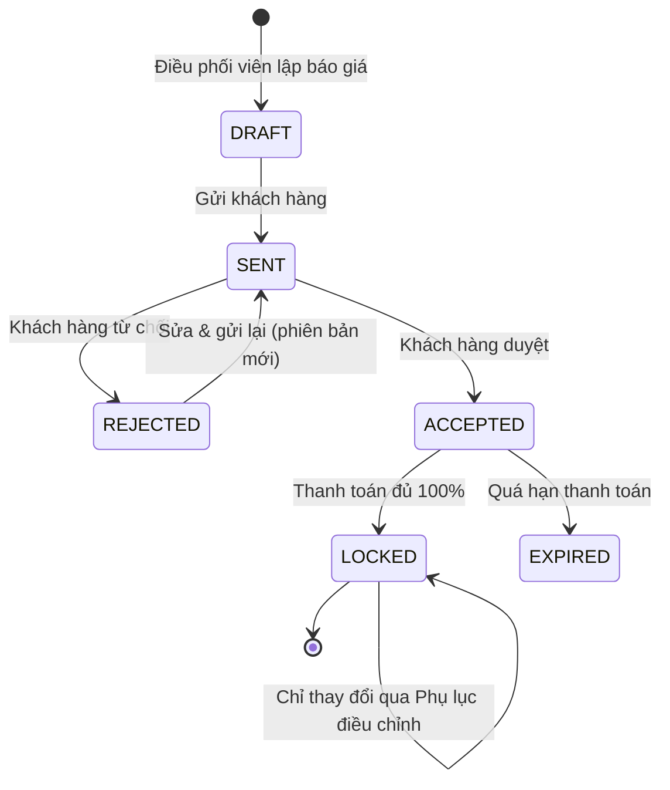

# PHẢN BIỆN TOÀN DIỆN BẢN THẢO SRS – RIKKEITRAVEL
## Phân hệ: Đặt tour trọn gói (khách hàng doanh nghiệp)

> **Vai trò:** Peer Reviewer độc lập · **Chuẩn áp dụng:** IEEE 830-1998

---

## 0. Kiến thức áp dụng

### 0.1 Tám đặc tính vàng của SRS (IEEE 830)

| # | Đặc tính | Câu hỏi kiểm tra nhanh |
|---|---|---|
| 1 | **Correct** (Đúng) | Yêu cầu có phản ánh đúng nhu cầu thật của khách hàng không? |
| 2 | **Unambiguous** (Không mơ hồ) | Có đúng **một** cách hiểu không? |
| 3 | **Complete** (Đầy đủ) | Đã mô tả phản ứng với **mọi** đầu vào, kể cả đầu vào **không hợp lệ**, chưa? |
| 4 | **Consistent** (Nhất quán) | Có yêu cầu nào **mâu thuẫn** với yêu cầu khác không? |
| 5 | **Ranked for importance/stability** (Xếp hạng) | Mỗi yêu cầu đã có **mức ưu tiên** và **độ ổn định** chưa? |
| 6 | **Verifiable** (Kiểm chứng được) | Có viết được test case cho kết quả Đạt/Không đạt bằng con số không? |
| 7 | **Modifiable** (Dễ sửa đổi) | Mỗi quy tắc có được viết **một lần duy nhất**, có tổ chức rõ ràng để sửa một chỗ là đủ không? |
| 8 | **Traceable** (Truy vết được) | Mỗi yêu cầu có mã định danh và liên kết được với Use Case hay nguồn gốc của nó không? |

### 0.2 Vị trí nội dung theo 3 chương IEEE 830

| Nội dung | Vị trí đúng |
|---|---|
| Phạm vi hệ thống | 1.2 Scope |
| Thuật ngữ, định nghĩa | 1.3 Definitions |
| Danh sách chức năng tổng thể, Use Case Diagram | 2.2 Product Functions |
| Đặc điểm người dùng (Actor) | 2.3 User Characteristics |
| Ràng buộc (công nghệ, pháp lý, phần cứng) | 2.4 Constraints |
| Yêu cầu chức năng chi tiết | 3.2 Functional Requirements |
| ERD, cấu trúc dữ liệu logic | 3.4 Logical Database Requirements |

---

## BƯỚC 1 — Bảng lỗi phát hiện được

| STT | Nội dung lỗi | Phân loại lỗi | Vị trí đúng hoặc cách khắc phục |
|---|---|---|---|
| **1** | Danh sách **Actor** (Nhân viên đặt tour, Điều phối viên) đặt ở **2.4 Constraints**. | **Sai vị trí IEEE 830** | Actor không phải ràng buộc. Chuyển mô tả Actor sang **2.3 User Characteristics**. |
| **2** | Danh sách **Use Case** (Tạo yêu cầu đặt tour, Duyệt báo giá, Xác nhận thanh toán) đặt ở **2.4 Constraints**. | **Sai vị trí IEEE 830** | Chuyển sang **2.2 Product Functions**, trình bày kèm Use Case Diagram tổng thể. |
| **3** | **Sơ đồ ERD** Yêu cầu đặt tour – Báo giá – Hợp đồng đặt ở **1.3 Definitions**. | **Sai vị trí IEEE 830** | ERD là đặc tả cấu trúc dữ liệu, nên chuyển sang **3.4 Logical Database Requirements**. Mục 1.3 chỉ chứa thuật ngữ. |
| **4** | Mục **1.3 Definitions** sau khi bỏ ERD thì **rỗng**. Các thuật ngữ cốt lõi ("tour trọn gói", "khách hàng doanh nghiệp", "báo giá", "hợp đồng") chưa được định nghĩa. | **Complete** (thiếu nội dung bắt buộc) + **Unambiguous** | Bổ sung bảng thuật ngữ tại **1.3** (xem Bước 2). |
| **5** | **REQ-21:** "phản hồi báo giá … **một cách nhanh chóng**". | **Verifiable** (không có con số để đo), kèm **Unambiguous** | Gắn thời hạn cụ thể theo giờ làm việc, cách tính mốc thời gian và tiêu chí kiểm chứng (xem Bước 2). |
| **6** | **REQ-22** chỉ mô tả trường hợp thanh toán **đủ 100%**. Nó bỏ sót các trường hợp thanh toán **thiếu**, **thừa**, **thất bại** và **quá hạn thanh toán**. | **Complete** (thiếu kịch bản dữ liệu không hợp lệ) | Bổ sung đủ các nhánh xử lý cho từng trường hợp (xem Bước 2). |
| **7** | **REQ-23** cho phép sửa báo giá "bất kỳ lúc nào, **kể cả sau khi đã thanh toán**", còn **REQ-24** nói sau thanh toán thì "**không ai được chỉnh sửa**". | **Consistent** (hai yêu cầu mâu thuẫn trực tiếp) | Hợp nhất thành **một quy tắc nghiệp vụ duy nhất BR-01** (xem Bước 2). |
| **8** | Cùng một chủ đề (quyền sửa báo giá) bị viết ở **2 nơi cách xa nhau** (trang 8 và trang 19). | **Modifiable** (quy tắc bị lặp và phân tán, sửa chỗ này dễ quên chỗ kia) | Quy tắc chỉ được định nghĩa **một lần** tại BR-01. Các yêu cầu khác chỉ **tham chiếu mã BR-01**, không viết lại nội dung. |
| **9** | **REQ-25:** "**có thể được cân nhắc** bổ sung sau, **tùy nguồn lực**". | **Ranked for importance/stability** (chưa xếp hạng), kèm **Unambiguous** (không rõ có phải làm hay không) | Gán mức ưu tiên, độ ổn định và bản phát hành cụ thể (xem Bước 2). |
| **10** | Phạm vi 1.2 quy định nhóm **từ 10 người trở lên**, nhưng không có yêu cầu nào mô tả cách hệ thống xử lý khi nhập **dưới 10 người**, **0 người**, **số âm** hay **vượt sức chứa tour**. | **Complete** (thiếu kịch bản dữ liệu không hợp lệ) | Bổ sung **REQ-20** kiểm tra số lượng thành viên đoàn. |
| **11** | Các REQ **không liên kết** với Use Case nào, nên không biết yêu cầu nào hiện thực hóa chức năng nào. | **Traceable** | Bổ sung cột "Use Case liên quan" và ma trận truy vết. |

**Tổng hợp:** 3 lỗi sai cấu trúc IEEE 830 (STT 1, 2, 3) và 8 lỗi vi phạm **7 đặc tính vàng khác nhau**: Complete, Unambiguous, Verifiable, Consistent, Modifiable, Ranked, Traceable.

---

## BƯỚC 2 — Bản chỉnh sửa hoàn chỉnh

> Các con số ngưỡng bên dưới là **đề xuất của reviewer**, cần khách hàng doanh nghiệp xác nhận trong buổi ký duyệt.

### CHƯƠNG 1 – INTRODUCTION

#### 1.2 Scope

Hệ thống hỗ trợ **khách hàng doanh nghiệp** đặt **tour trọn gói** cho đoàn từ **10 người trở lên**, gồm các bước: tạo yêu cầu đặt tour, nhận và duyệt báo giá, thanh toán và xác nhận hợp đồng.
**Ngoài phạm vi:** đặt tour cho khách lẻ (dưới 10 người), đặt vé máy bay riêng lẻ, quản lý hướng dẫn viên.

#### 1.3 Definitions, Acronyms, Abbreviations

| Thuật ngữ | Định nghĩa |
|---|---|
| **Khách hàng doanh nghiệp** | Tổ chức có mã số thuế, đã ký thỏa thuận khung với RikkeiTravel. |
| **Tour trọn gói** | Sản phẩm du lịch gồm vận chuyển, lưu trú, ăn uống và tham quan theo lịch trình cố định, tính một giá cho cả đoàn. |
| **Báo giá** | Văn bản do Điều phối viên lập, nêu tổng giá trị, chi tiết dịch vụ và thời hạn hiệu lực. Mỗi lần sửa tạo ra một **phiên bản mới** (v1, v2…). |
| **Hợp đồng** | Báo giá đã được khách hàng duyệt, có giá trị pháp lý giữa hai bên. |
| **Phụ lục điều chỉnh** | Văn bản thay đổi nội dung hợp đồng sau khi đã thanh toán, cần cả hai bên phê duyệt (xem BR-01). |
| **Giờ làm việc** | 08:00–17:30, thứ Hai đến thứ Sáu, trừ ngày lễ theo quy định Việt Nam. |

### CHƯƠNG 2 – OVERALL DESCRIPTION

#### 2.2 Product Functions *(chuyển từ 2.4 – lỗi STT 2)*

| Mã UC | Use Case | Actor thực hiện |
|---|---|---|
| UC-01 | Tạo yêu cầu đặt tour | Nhân viên đặt tour |
| UC-02 | Duyệt báo giá | Nhân viên đặt tour (duyệt) · Điều phối viên (lập, chỉnh sửa) |
| UC-03 | Xác nhận thanh toán | Nhân viên đặt tour |

*(Use Case Diagram tổng thể được đặt tại mục này.)*

#### 2.3 User Characteristics *(chuyển từ 2.4 – lỗi STT 1)*

| Actor | Đặc điểm |
|---|---|
| **Nhân viên đặt tour** | Nhân viên phía khách hàng doanh nghiệp, thường thuộc phòng Hành chính – Nhân sự. Có kỹ năng tin học văn phòng cơ bản. |
| **Điều phối viên RikkeiTravel** | Nhân viên nội bộ, am hiểu sản phẩm tour và chính sách giá. Chịu trách nhiệm lập và điều chỉnh báo giá. |

#### 2.4 Constraints

*(Mục này chỉ chứa ràng buộc thực sự.)* Ví dụ: hợp đồng và báo giá phải lưu trữ tối thiểu **10 năm** theo quy định kế toán; mọi thay đổi trên báo giá phải được ghi nhật ký kiểm toán.

### CHƯƠNG 3 – SPECIFIC REQUIREMENTS

#### 3.2 Functional Requirements

**Quy tắc nghiệp vụ dùng chung**

> **BR-01 – Quy tắc khóa báo giá** *(thay thế và hợp nhất REQ-23, REQ-24 – lỗi STT 7, 8)*
> 1. Điều phối viên **được** chỉnh sửa báo giá khi báo giá ở trạng thái `DRAFT`, `SENT` hoặc `REJECTED`, tức là **trước khi** khách hàng thanh toán đủ 100%. Mỗi lần lưu tạo một phiên bản mới và gửi lại cho khách hàng duyệt.
> 2. Khi khách hàng thanh toán **đủ 100%** (REQ-22), báo giá chuyển sang `LOCKED`. **Không ai**, kể cả Điều phối viên hay quản trị viên, được sửa trực tiếp báo giá đã khóa.
> 3. Mọi thay đổi sau khi khóa **chỉ** được thực hiện bằng **Phụ lục điều chỉnh**: Điều phối viên tạo phụ lục, Nhân viên đặt tour phê duyệt, hệ thống lưu thành phiên bản mới gắn với hợp đồng. Bản báo giá gốc giữ nguyên, không bị ghi đè.
> 4. Mọi thao tác trên báo giá và phụ lục đều được ghi nhật ký kiểm toán (người thực hiện, thời điểm, giá trị trước/sau).

**Danh sách yêu cầu chức năng**

| Mã | Use Case | Đặc tả yêu cầu | Tiêu chí kiểm chứng |
|---|---|---|---|
| **REQ-20** *(bổ sung – lỗi STT 10)* | UC-01 | Khi tạo yêu cầu đặt tour, hệ thống **phải** kiểm tra số thành viên đoàn là số nguyên **≥ 10** và **≤ sức chứa tối đa** của tour. Nếu vi phạm thì không cho gửi yêu cầu và hiển thị: dưới 10 → "Tour trọn gói áp dụng cho đoàn từ 10 người trở lên"; bằng 0, số âm hoặc không phải số → "Số thành viên phải là số nguyên dương"; vượt sức chứa → "Tour chỉ nhận tối đa N người". | Nhập 9, 0, –5, "abc" và (N+1) thì cả 5 trường hợp bị chặn và hiển thị **đúng** thông báo. Nhập 10 thì gửi yêu cầu thành công. |
| **REQ-21** *(viết lại – lỗi STT 5)* | UC-02 | Sau khi nhận yêu cầu đặt tour hợp lệ, hệ thống **phải** gửi báo giá phiên bản đầu (v1) cho khách hàng trong **≤ 4 giờ làm việc**, tính từ thời điểm yêu cầu được ghi nhận. Nếu còn **1 giờ** mà báo giá chưa được gửi, hệ thống tự động cảnh báo Trưởng nhóm điều phối qua email. | Đo trên dữ liệu **1 tháng** vận hành: **≥ 95%** yêu cầu có báo giá gửi trong ≤ 4 giờ làm việc. Giả lập một yêu cầu quá 3 giờ chưa xử lý thì email cảnh báo được gửi. |
| **REQ-22** *(bổ sung – lỗi STT 6)* | UC-03 | Khi nhận kết quả thanh toán cho báo giá đã `ACCEPTED`, hệ thống **phải**:  (a) **Đủ 100%:** chuyển đơn sang **"Đã xác nhận"** và khóa báo giá theo **BR-01**.  (b) **Chưa đủ 100%:** giữ trạng thái "Chờ thanh toán", hiển thị số tiền còn thiếu.  (c) **Vượt 100%:** vẫn xác nhận đơn, ghi nhận số tiền thừa và tạo yêu cầu hoàn tiền trong **≤ 1 ngày làm việc**.  (d) **Giao dịch thất bại:** không đổi trạng thái, thông báo lỗi và cho phép thanh toán lại.  (e) **Quá 7 ngày** kể từ khi duyệt báo giá mà chưa thanh toán đủ: chuyển báo giá sang `EXPIRED`. | Chạy 5 test case (a)–(e): **100%** đơn có trạng thái và thông báo đúng như đặc tả. |
| **REQ-23** *(viết lại, tuân theo BR-01)* | UC-02 | Điều phối viên **phải** chỉnh sửa được báo giá ở trạng thái `DRAFT`, `SENT`, `REJECTED`. Với báo giá `LOCKED`, nút "Chỉnh sửa" bị vô hiệu hóa và chỉ còn nút "Tạo phụ lục điều chỉnh". | Sửa báo giá `SENT` thì tạo được v2. Gọi API sửa báo giá `LOCKED` thì bị từ chối (HTTP 403) và có ghi nhật ký. |
| ~~REQ-24~~ | — | **Đã hợp nhất vào BR-01** (điểm 2), không còn là yêu cầu riêng để tránh lặp nội dung. | — |
| **REQ-25** *(bổ sung xếp hạng – lỗi STT 9)* | UC-02 | Hệ thống **phải** cho phép Nhân viên đặt tour và Điều phối viên **xuất báo giá** (mọi phiên bản) ra file **PDF khổ A4**, có logo RikkeiTravel, mã báo giá, số phiên bản và thời điểm xuất, trong **≤ 5 giây**. | Xuất báo giá có 20 dòng dịch vụ: file PDF mở được, đủ các trường, thời gian xuất ≤ 5 giây. |

#### Xếp hạng mức độ ưu tiên *(lỗi STT 9)*

| Mã | Mức ưu tiên (MoSCoW) | Độ ổn định | Bản phát hành | Lý do |
|---|---|---|---|---|
| REQ-20 | **Must have** | Cao | Release 1.0 | Đảm bảo đúng phạm vi sản phẩm |
| REQ-21 | **Must have** | Trung bình (thời hạn có thể điều chỉnh theo SLA hợp đồng) | Release 1.0 | Cam kết dịch vụ với khách doanh nghiệp |
| REQ-22 | **Must have** | Cao | Release 1.0 | Liên quan trực tiếp đến dòng tiền |
| REQ-23 + BR-01 | **Must have** | Cao | Release 1.0 | Bảo vệ tính pháp lý của hợp đồng |
| **REQ-25** | **Could have** (Tùy chọn – *Optional*) | Trung bình | **Release 1.1** (dự kiến 2 tháng sau Release 1.0) | Tiện ích xuất tài liệu. Chưa có PDF thì khách hàng vẫn xem được báo giá trực tuyến, nên **không chặn** việc ký duyệt Release 1.0. |

#### 3.4 Logical Database Requirements *(chuyển từ 1.3 – lỗi STT 3)*

*(Sơ đồ ERD Yêu cầu đặt tour – Báo giá – Hợp đồng được đặt tại mục này.)* Tóm tắt quan hệ: một **Yêu cầu đặt tour** có nhiều **Báo giá** (theo phiên bản). Một **Báo giá** được chấp nhận sinh ra đúng một **Hợp đồng**. Một **Hợp đồng** có thể có nhiều **Phụ lục điều chỉnh**.

---

## Ma trận truy vết *(lỗi STT 11)*

| Use Case | Yêu cầu liên quan | Quy tắc nghiệp vụ |
|---|---|---|
| UC-01 Tạo yêu cầu đặt tour | REQ-20 | — |
| UC-02 Duyệt báo giá | REQ-21, REQ-23, REQ-25 | BR-01 |
| UC-03 Xác nhận thanh toán | REQ-22 | BR-01 |
